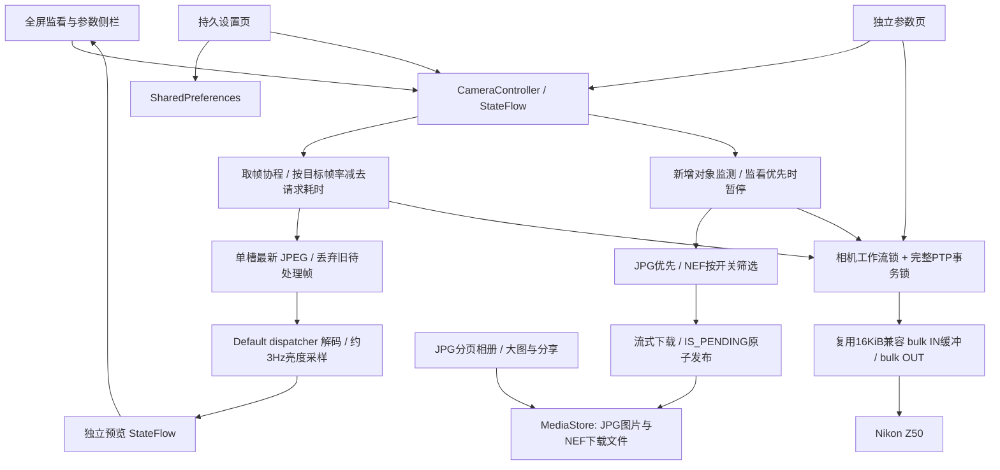

# 0.4.0 架构

0.4.0：根界面使用 HorizontalPager 统一承载参数/监看/相册/设置，与底部导航和历史回退同步。监看顶部工具栏以 + 开启更多设置；工具栏和底部导航的可见性持久保存，参数信息仍叠加在预览上。

CameraIso 分离标准 ISO 设置 0x500F、Nikon 自动 ISO 开关 0xD054 和只读控制值 0xD0B5。属性未公布不发送请求，不猜测取景包里的 ISO 偏移。

相机媒体：CameraListing 按存储卡和父对象目录加载 ObjectInfo，CameraEntry 带本次连接 token，传输前回读确认对象身份。缩略图使用 0x100A，原图预览流到 cacheDir；手动保存 JPG/NEF 走 MediaLibrary 原子保存。NEF 必须与原 JPG 同卡、同目录、同名。

本地媒体：ImportedPhoto 增加分类、垃圾桶、来源、到期字段。SharedPreferences 保存相机/原文件名/存储卡/父目录/大小，不把 MediaStore 可能改名后的显示名称当作唯一来源。Android 11+ 查询包含系统垃圾桶，Android 10 使用 Trash 目录兼容。所有写操作重新核对本应用媒体白名单，永久删除只接受当前已在垃圾桶的 JPG。手机导入通过系统文档选择器复制原 JPG。

下面保留之前版本的传输和解码设计记录。

0.3.0：CameraController 依赖 PtpSession，UsbPtpSession 和 WifiPtpSession 分别提供 USB/PTP 与 TCP/PTP-IP。下图沿用 USB 路径示意；Wi-Fi 会话以独立命令/数据及事件 Socket 连接相机服务，默认端口 15740，绑定 Android 当前可见 Wi-Fi Network。事件连接处理心跳，照片监测仍采用对象列表轮询，不依赖未验证的 Nikon 私有事件格式。

参数同步协程与拍摄、传图、取景共享 cameraLock，各会话再以事务锁保护完整命令/数据/响应序列。参数采用 GetDevicePropValue 回读、描述定时刷新、调节前重读范围、写后确认。应用界面不乐观地把目标值当作成功值；无效范围禁用调整，数值边界停止。

监看参数是画面信息叠加层，点参数弹出调节，取消侧栏。导航包含参数/相册/设置且可隐藏。页面历史使用可保存列表，当前页面为栈顶；返回弹出一项。SaveableStateHolder 保留页面状态。

相册支持跨页选择，分享使用 ACTION_SEND / ACTION_SEND_MULTIPLE，ClipData 覆盖所有授权 URI；删除前确认并重新查询应用自有 JPG 白名单。只调用 MediaStore 删除本地图片。

无线兼容性和相机 LCD 元素限制详见 RELEASE_0.3.0.md。以下 0.2.x 设计记录保留用于解释已有预览流水线。

PTP 仍是串行协议：每个命令、可选数据和响应必须作为整体执行。不能同时发多个取帧请求来追求帧率，否则可能打乱事务。新版并行的是 USB 取帧与 CPU 解码；两者间的单元素队列防止旧画面堆积。

默认监看优先会跳过卡片扫描和整文件下载。关闭该选项后，PTP 互斥仍保证协议正确，但大文件 GetObject 会占用通道，无法保证视频连续。因此用户有明确的取景优先/边看边传取舍。

预览流不放进普通界面 StateFlow：只有监看页订阅 Bitmap 和直方图。参数、相册、设置不因每帧图像到达重新订阅整个状态。

MediaLibrary 接受原始 ObjectInfo 和流式下载回调。JPG 写入图片集合；NEF 写入下载集合。IS_PENDING=1 创建，收到成功响应且长度一致后发布，异常清理未完成项。相册按目录、MIME、完成状态和 OWNER_PACKAGE_NAME 限制到本应用导入的 JPG。大图和缩略图在 IO dispatcher 加载。

参数仍通过 GetDevicePropDesc 枚举/范围 → SetDevicePropValue → 回读验证，支持标准 ISO/快门/光圈。Nikon 实时取景仍沿用此前可用的 0x9201/0x9203/0x9202，没有引入未证实的新厂商操作码。

设置保存帧率、解码尺寸、网格、直方图、裁切填满、监看优先、NEF、自动传图、扫描间隔、横屏、常亮、沉浸、后台暂停和自动取景。后台暂停会避开 Activity 配置变化，旋转不会因为 onStop 自动结束取景。

当前没有后台服务、断点续传、旧照片导入或事件端点增量监听。仍需 Z50 真机验证连续拍摄/取景切换、取景优先停止后补传、长时间运行与 CPU/USB 瓶颈。

0.2.1：PTP 容器读取/会话状态由纯 Kotlin PtpStream 管理，Android USB 适配器通过 PtpPacketIo 调用；兼容读取固定 16KiB。8 项传输回归测试可在无相机情况下验证短包、剩余数据、超时和旧会话处理，但不替代硬件测试。默认首页为参数，监看顶部使用常驻四页导航。

